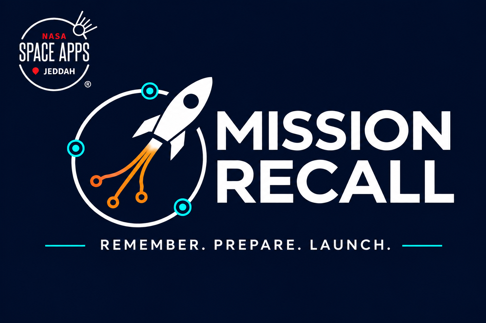

# Mission Recall 🚀

**Remember. Prepare. Launch.** A NASA-inspired memory puzzle built with Unreal Engine. Play as an astronaut, recall visual and auditory patterns to prepare fuel routing, navigation and life support, then board the rocket and launch to win.

## Download

[Download Mission Recall — UE 5.8 source starter](https://github.com/Mking99213/test-my-IQ/raw/refs/heads/main/downloads/MissionRecall-UE5.8-Starter.zip)

Target configuration: Unreal Engine 5.8, for the owner's 5.8.4 installation. Includes complete C++ source, Visual Studio Code build tasks, original audio cues, editor map generation, session CSV results, presentation notes and branding.

## Run

1. Install UE 5.8.4 and its supported MSVC compiler/Windows SDK. VS Code alone does not contain a compiler.
2. Extract to a fresh directory and open `MissionRecall/MissionRecall.code-workspace` in VS Code.
3. Press Ctrl+Shift+B to build MissionRecallEditor. Enter your engine root, normally `C:/Program Files/Epic Games/UE_5.8`.
4. Open `MissionRecall.uproject` in Unreal; choose Tools → Execute Python Script → `Scripts/create_map.py`.
5. Restart Unreal, open Content/Maps/LaunchSite and press Play.

M selects Visual / Audio / Both before starting; Space starts or launches; 1–4 repeat the pattern; WASD moves; R restarts.

- [Unreal setup](MissionRecall/Docs/SETUP.md)
- [VS Code setup](MissionRecall/Docs/VSCODE.md)
- [Upgrade and rename notes](MissionRecall/Docs/UPGRADE_5_8.md)
- [Hackathon presentation](MissionRecall/Docs/HACKATHON_PRESENTATION.md)
- [Comparison protocol](MissionRecall/Docs/COMPARISON_PROTOCOL.md)

## Branding

The new professional logo combines a rocket, orbit and memory nodes, with a reference-based recreation of the supplied NASA Space Apps Jeddah mark at the top-left. It is not the official source artwork and does not imply endorsement. The PNG is included under Assets/Branding for repository artwork, slides and optional UMG use. The in-game HUD displays the new Mission Recall title as text.

## Validation

Portable C++ mission tests, Python syntax, JSON configurations, rename consistency and ZIP integrity pass. Full Unreal compilation, editor execution, audio timing and packaging require local verification; Unreal is not installed in the delivery environment. The download contains source, not a standalone executable.

Patterns reduce reliance on learned facts, but universal fairness and cognitive benefits are not established. This game is not a validated IQ test, clinical tool or astronaut-selection instrument. Independent project; no NASA endorsement is claimed.
