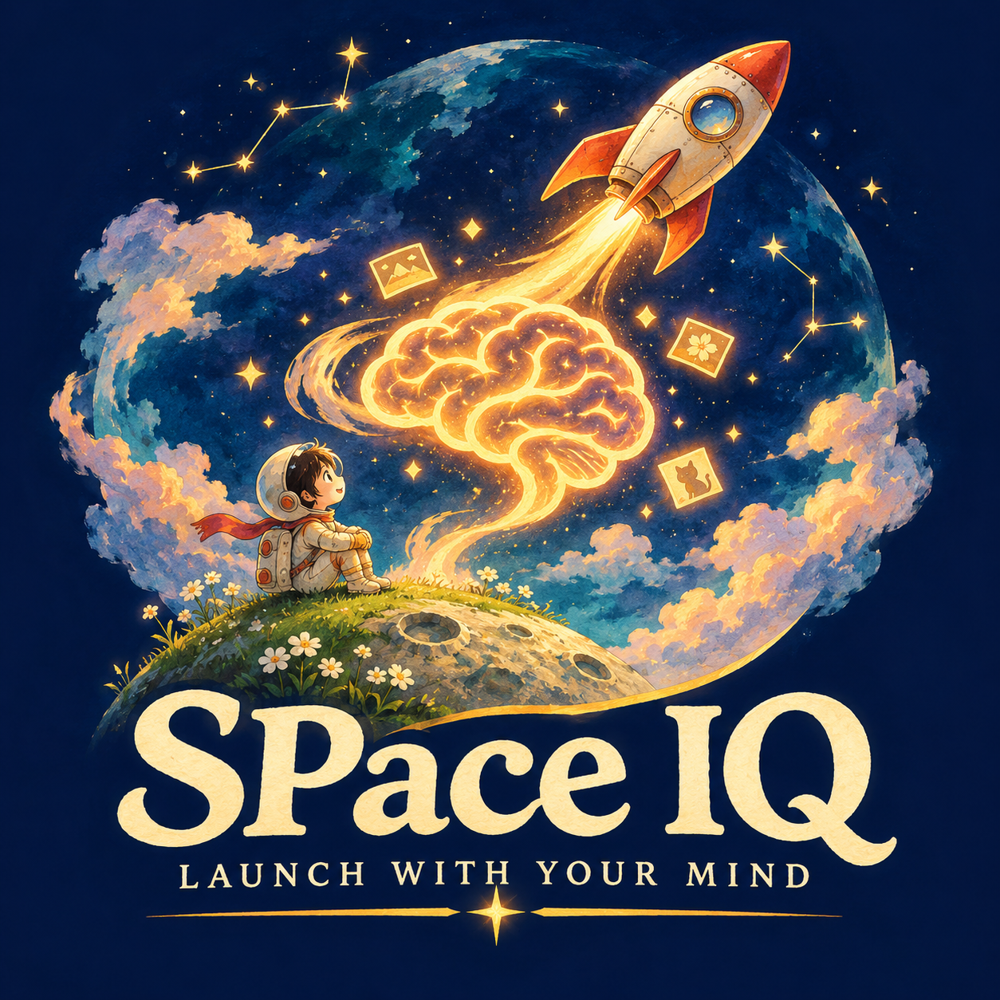

# SPace IQ 🚀

A NASA-inspired Unreal Engine memory puzzle: an astronaut prepares fuel routing, navigation and life support through visual and auditory pattern recall, then boards a rocket and launches into space.

## Download

[Download SPace IQ — UE 5.8 source starter](https://github.com/Mking99213/test-my-IQ/raw/refs/heads/main/downloads/SPaceIQ-UE5.8-Starter.zip)

Target configuration: **Unreal Engine 5.8**, for the owner's **5.8.4** installation. This source upgrade has not been compiled against Unreal in the delivery environment.

## Run in Unreal and Visual Studio Code

1. Finish installing UE 5.8.4 and install the MSVC/Windows SDK versions supported by that engine. VS Code alone does not include a compiler.
2. Extract the ZIP into a new folder and open `SPaceIQ/SPaceIQ.code-workspace` in VS Code.
3. Press Ctrl+Shift+B and run the Editor build. Enter your engine root, normally `C:/Program Files/Epic Games/UE_5.8`.
4. Open `SPaceIQ.uproject` in Unreal. Run `Scripts/create_map.py` through Tools → Execute Python Script. Restart Unreal after the first audio import.
5. Open Content/Maps/LaunchSite and press Play.

M chooses Visual / Audio / Both before starting; Space starts or launches; 1–4 repeat the pattern; WASD moves; R restarts.

- [Full setup](SPaceIQ/Docs/SETUP.md)
- [VS Code instructions](SPaceIQ/Docs/VSCODE.md)
- [UE 5.8 upgrade notes](SPaceIQ/Docs/UPGRADE_5_8.md)
- [Hackathon presentation](SPaceIQ/Docs/HACKATHON_PRESENTATION.md)
- [Participant comparison protocol](SPaceIQ/Docs/COMPARISON_PROTOCOL.md)

The logo is supplied as an original generated branding image; it does not automatically replace the in-game text HUD. Import it into Unreal and use a UMG Image widget to add it to your own menu.

## Validation

Portable C++ rules tests, Python syntax, JSON consistency, migration checks and archive integrity pass. UnrealHeaderTool, native engine compilation, editor gameplay, audio timing and packaged execution require local verification. This is source code, not a prebuilt game.

Pattern tasks reduce reliance on learned facts, but universal fairness and cognitive benefits have not been established. SPace IQ is not a validated IQ test or astronaut-selection instrument. Independent project, not affiliated with or endorsed by NASA.
